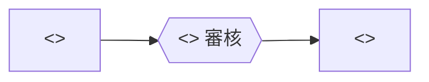

# Rule 1 - 樣板組由骨架與範例兩個檔案組成

- 每個樣板組必須由一個骨架檔與一個範例檔組成。
- 骨架檔必須命名為 `templates/<樣板名字>.<格式>`。
- 範例檔必須命名為 `templates/<樣板名字>.example.<格式>`。
- 同一個樣板組的骨架與範例必須使用相同的 `<樣板名字>` 與 `<格式>`。
- `<格式>` 必須是產出物的副檔名；產出物直接輸出在對話中時，必須使用 `md`。
- 建立樣板組時必須同時建立骨架與範例。
- 修改骨架或範例其中一個檔案的結構時，必須同步修改另一個檔案。

## Example

- 兩個樣板組都成對存在，骨架與範例只差在 `.example`，副檔名與產出物相同。

```text
templates/class-diagram.mmd
templates/class-diagram.example.mmd
templates/release-note.md
templates/release-note.example.md
```

# Rule 2 - 一個樣板組只對應一種產出物

- 一個樣板組必須只規範一種產出物的格式。
- `<樣板名字>` 必須以產出物的名稱命名。
- 英文的 `<樣板名字>` 必須使用 kebab-case。
- 同一個步驟產生多種產出物時，必須為每種產出物建立各自的樣板組。

## Example

- 同一個步驟產生的類別圖與設計說明是兩種產出物，各自擁有以產出物命名的樣板組。

| 產出物   | 樣板組                                                          |
| -------- | --------------------------------------------------------------- |
| 類別圖   | `templates/class-diagram.mmd`、`templates/class-diagram.example.mmd` |
| 設計說明 | `templates/design-note.md`、`templates/design-note.example.md`   |

# Rule 3 - 骨架整份檔案就是樣板

- 骨架的全部內容必須是產出物的格式樣板，使執行者複製整份骨架後只需改寫 placeholder。
- 骨架不得加入不屬於產出物的檔案標題、用途說明或使用步驟。
- 產出物中每次都相同的內容必須以字面值寫在骨架中。
- 產出物中每次不同的內容必須以 placeholder 表示，不得以具體的示範內容代替。

## Example

- 骨架從產出物的第一行開始；固定的段落標題是字面值，版本號與摘要是 placeholder。

```markdown
# {{VERSION}}

## 摘要

{{RELEASE_SUMMARY}}
```

# Rule 4 - Placeholder 使用一致且可辨識的格式

- Placeholder 必須使用 `{{UPPER_SNAKE_CASE}}` 格式。
- 目標格式的語法已使用 `{{` 或 `}}` 時，必須改用目標格式語法未使用的定界符，並在骨架第一行以指示註解宣告；指示註解的寫法依 Rule 5。
- 同一個樣板組必須只使用一種定界符。
- Placeholder 名稱必須表明要填入的內容，不得使用 `{{TEXT_1}}` 等無法判斷用途的名稱。
- 骨架中多個位置必須填入相同內容時，必須使用同一個 placeholder 名稱。
- 填入內容不同的位置不得共用 placeholder 名稱。

## Example

### Example 1

- 使用預設定界符；版本號在標題與下載連結必須相同，因此共用 `{{VERSION}}`。

```markdown
# {{VERSION}}

發佈日期：{{RELEASE_DATE}}

下載：https://example.com/download/{{VERSION}}
```

### Example 2

- Mermaid flowchart 以 `{{ }}` 表示六角形節點，因此改用 `<<NAME>>`，並在第一行宣告。



# Rule 5 - 可變結構必須以指示註解標示

- 指示註解必須使用目標格式的原生註解語法，並以 `樣板指示：` 開頭，使執行者能辨識並在產出物中刪除。
- 數量不固定的重複區塊，骨架必須只寫出一個區塊，並在該區塊前以指示註解說明重複條件。
- 重複區塊內的 placeholder，每次重複時可以填入不同內容。
- 可以省略的區塊，骨架必須在該區塊前以指示註解說明保留條件。
- 指示註解必須只用於宣告定界符、說明重複條件或說明保留條件。
- 目標格式不支援註解時，骨架不得加入指示文字。

## Example

- 「新增」的條列數量不固定，只寫一列並說明重複條件；「已知問題」可以省略，並說明保留條件。

```markdown
# {{VERSION}}

## 新增

<!-- 樣板指示：每項新增功能重複一列。 -->
- {{ADDED_ITEM}}

<!-- 樣板指示：沒有已知問題時刪除本段落。 -->
## 已知問題

<!-- 樣板指示：每項已知問題重複一列。 -->
- {{KNOWN_ISSUE}}
```

# Rule 6 - 範例必須是骨架的完整填寫結果

- 範例必須保留骨架的固定內容與區塊順序。
- 範例不得加入骨架沒有的結構。
- 範例不得殘留 placeholder 或指示註解。
- 範例應將重複區塊展開為兩個以上的區塊。
- 範例應保留可以省略的區塊。
- 範例的全部內容必須來自同一個具體情境，不得使用「範例文字」或 `foo` 等無意義內容。

## Example

- 範例沿用 Rule 5 骨架的標題與段落順序，重複區塊展開為兩列，內容都來自同一次請假系統的發佈。

```markdown
# v2.3.0

## 新增

- 支援以 CSV 匯出請假紀錄。
- 主管審核頁新增批次核准。

## 已知問題

- 跨年度請假的剩餘天數在 Safari 顯示為空白。
- 批次核准超過 200 筆時回應時間超過 10 秒。
```

# Rule 7 - 樣板組只規範格式，不承載判準

- 樣板組必須只規範產出物的結構與格式。
- 用來判斷內容是否合格的判準不得寫入骨架、指示註解或範例；判準必須放在 RuleFile。
- 樣板組不得重述同一個 Skill 的 RuleFile、腳本或 SOP 步驟內文已規範的要求。

## Example

- 段落組成與順序由骨架固定；內容是否合格無法由骨架保證，因此歸屬 RuleFile。

| 要求                                 | 歸屬     |
| ------------------------------------ | -------- |
| Release note 依序包含「新增」與「已知問題」段落 | 樣板組   |
| 每項新增功能使用一列條列             | 樣板組   |
| 每項新增功能必須說明使用者可見的變化 | RuleFile |
| 已知問題必須附上重現條件             | RuleFile |

# Rule 8 - 樣板組必須由 SKILL.md 成對載入

- 擁有樣板組的 `SKILL.md` 必須以 `READ` 步驟按需載入樣板組，且只載入當前任務需要的樣板組。
- 載入樣板組的 `READ` 步驟必須在同一個步驟列出骨架與範例兩個檔案的路徑。
- 載入步驟的提名位置、適用條件與載入結果命名，依 `skill-form-sop` 的 `rules/reference-rule.md`。

## Example

- 同一個 `READ` 步驟列出骨架與範例的路徑並命名載入結果，後續步驟只引用該名稱。

```markdown
1. `READ` 使用者需求與本次發佈的變更清單。
2. `READ` `templates/release-note.md` 與 `templates/release-note.example.md`，建立 release note 樣板組。
3. `WRITE` 依已載入的 release note 樣板組，複製骨架並改寫 placeholder，產生 release note。
4. `CHECK` 產出的 release note 結構與 release note 樣板組的骨架一致，且沒有殘留 placeholder 或指示註解。
```
